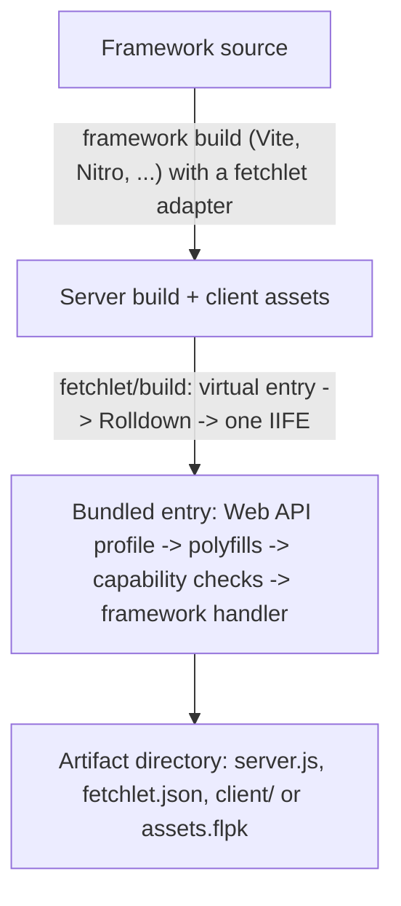
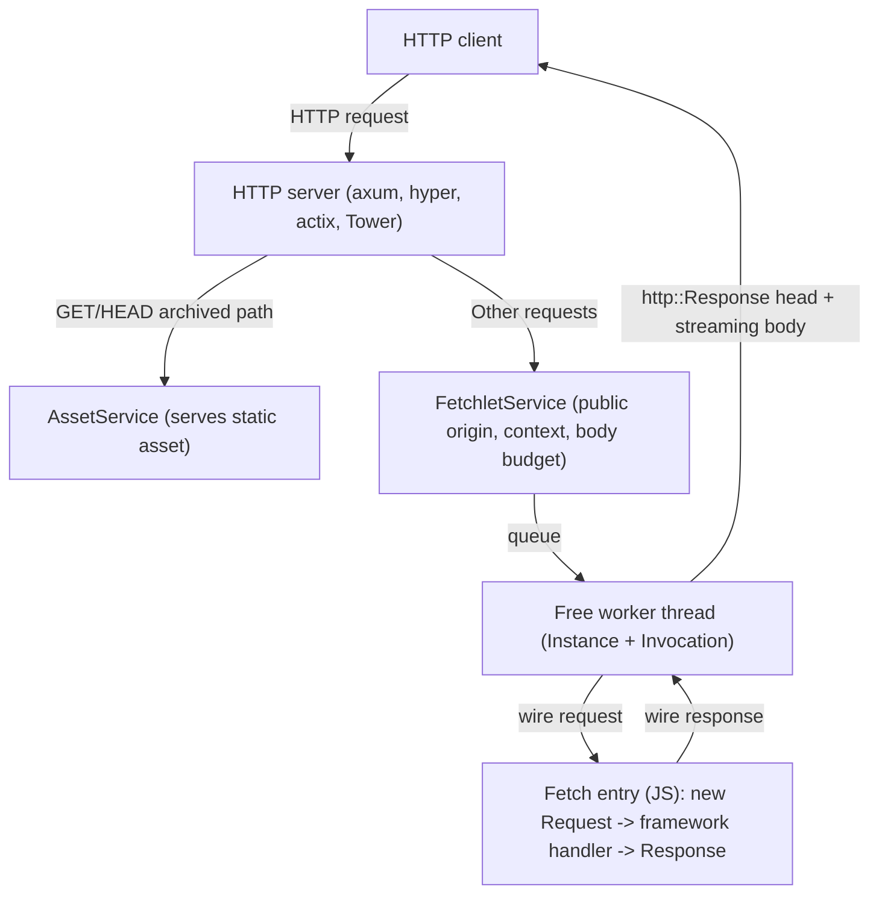
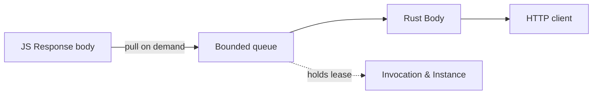
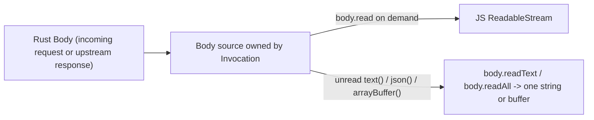
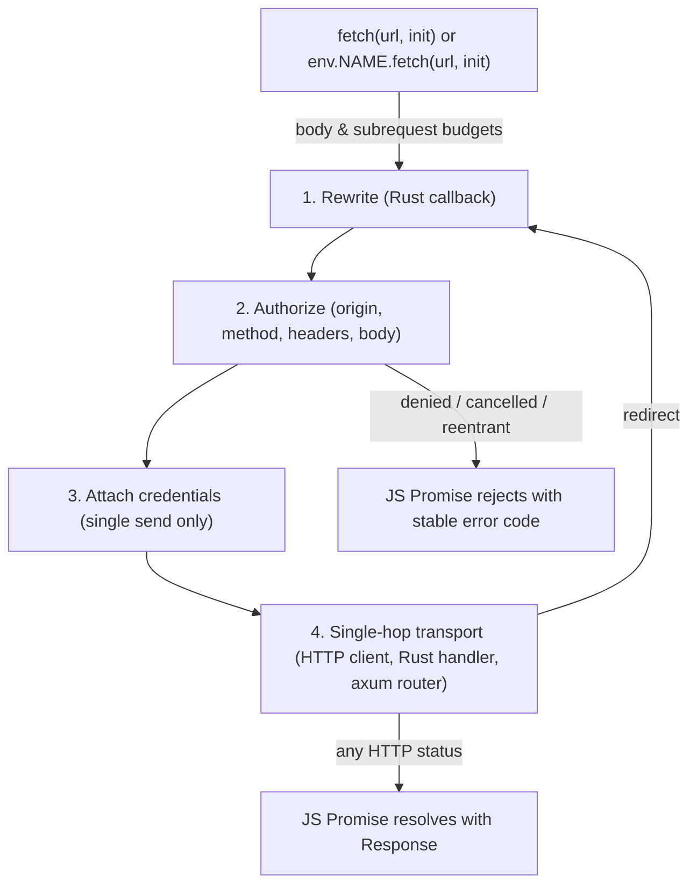

This page follows data through fetchlet: from framework source to an
artifact, from an HTTP request to JavaScript and back, and from JavaScript
`fetch` out to Rust. [Domain model](/docs/concepts/domain-model) defines the parts.

## Build: framework source to artifact

Each adapter hooks into its framework's build, passes `fetchlet/build` an
entry that connects the framework's server output to
`createFetchHandler`, and lets the framework emit its client assets. The
entry is a virtual module, so nothing is written next to the sources.
`archiveArtifactAssets` turns the client directory into an
[asset archive](/docs/reference/asset-archive).

Rust reads the artifact at run time with `Artifact::open(dir)` or embeds it
with `fetchlet_http::include_artifact!(dir)`.

## Request: HTTP to JavaScript and back

The wire request carries the URL, method, header pairs and the body: bytes
for a buffered body, or a body source for a streamed one. Binary bodies
cross the bridge as typed arrays through the invocation's byte store; the
JSON messages carry only handle numbers.

## Response bodies

- `AppHandle::fetch` returns once the handler produces the response head.
  The worker pulls body chunks as the queue (`response_body_queue`, default
  one chunk) has room. JavaScript merges available chunks up to 64 KiB per
  bridge message; that is backpressure granularity, not a budget.
- While the body is unfinished the invocation keeps its scope, deadline and
  instance, and the worker starts no other call.
- `timeout` covers the call until the body completes, including time the
  worker waits for the consumer to make room. When it passes, the body ends
  with `DeadlineExceeded` after the chunks already queued, and the worker
  releases the instance without waiting for the consumer. `response_body_bytes`
  is checked against the running total; exceeding it cancels the JavaScript
  stream.
- Dropping the Rust body between pulls cancels the JavaScript stream
  cooperatively and keeps the instance. Dropping it during a pull abandons
  the evaluation and retires the instance.
- `App::fetch` uses the same path and collects the whole body.

A response whose body is still bytes (a string or buffer passed to
`new Response`) goes to the wire without creating a stream.

## Request and upstream bodies

- A body that is not buffered — wrapped with `Body::from_http_body`, or
  passed through by `stream_request_bodies()` — reaches the handler as
  `request.body` and is read one chunk at a time.
- `text()`, `json()`, `arrayBuffer()`, `bytes()`, `blob()` and `formData()`
  on such a body, before any chunk was read from its stream, take it whole
  instead: Rust collects the rest of the body under the same budget and
  hands it over in one host step, as one buffer, or for `text()` and
  `json()` as a string Rust decoded as UTF-8. The stream stays locked, as
  a fully read stream is. A stream that was read, teed by `clone()` or
  piped takes the chunk path.
- A declared length (size hint or `Content-Length`) over
  `request_body_bytes` fails before execution with `LimitExceeded`.
  Undeclared excess is detected from the running total and errors the stream
  with code `LIMIT_EXCEEDED`. A failing body errors it with `TRANSPORT`; the
  detail stays in Rust.
- Upstream response bodies of host fetches use the same body sources under
  `response_body_bytes`. Bodies of followed redirects are discarded unread.
- Cancelling the stream, aborting the fetch, finishing the body or ending
  the invocation drops the body source, which cancels the producer.
- Outbound request bodies with a source, such as bytes or a string, are
  read in full inside JavaScript before they are sent, because a redirect
  may resend them. A `ReadableStream` body streams: each chunk the
  transport waits for is pulled from JavaScript at the next host step, and
  a redirect other than 303 fails the fetch
  ([streaming request bodies](/docs/rust/host-services#streaming-request-bodies)).

## Outbound fetch: JavaScript to Rust

The invocation polls transport futures directly and wakes the engine on a
waker notification or the next JavaScript timer. With `OriginRouter`, an
internal origin is handled in-process by a Rust handler or axum router that
receives the trusted `Context`; [in-process fetch](/docs/rust/in-process-fetch)
describes the routing and reentrancy rules.

## Background work

`fetchlet.waitUntil(promise)` — exposed by `fetchlet/runtime` and passed to
frameworks as `platform.context.waitUntil` (SvelteKit),
`Astro.locals.waitUntil` and similar — registers work that may outlive the
response.

- Registration is accepted only during an invocation; `background_tasks`
  limits the count (`LIMIT_EXCEEDED`), and outside an invocation it fails
  with `INVOCATION_CLOSED`.
- When the result or body finishes with work pending, the invocation stays
  open with its host scope and timers; host fetches and upstream reads
  continue.
- `App::finish_background` waits for the work, within `background_timeout`
  counted from the end of the result or body. Work that misses the deadline
  retires the instance and reports `DeadlineExceeded`. An `AppHandle` worker
  finishes background work before its next command.
- Rejections are absorbed; they do not change the response.

Without background work, remaining timers are discarded when the call ends.

## Cancellation and errors

Cancellation travels with ownership. Dropping the call's future, an expired
deadline or a disconnected client ends the invocation, which drops its host
futures and body sources, which cancels their producers. An instance whose
state is then uncertain is retired. A worker with
`CancelledCalls::Finish` does not drop the call when its caller leaves: the
evaluation in progress returns within the deadline, an open body is then
cancelled, and the invocation ends normally.

The handler sees the client leave through its `Request`'s `signal`, which
aborts before the response body is cancelled. Under `Finish` it also aborts
while the handler or a body pull is still running, so a server-sent event
stream or a streaming render can stop at once. Under the default `Retire`,
an evaluation the client leaves is abandoned with its instance and sees no
abort. A request whose response completes never aborts.

| Where it fails                | What the caller sees                                                 |
| ----------------------------- | -------------------------------------------------------------------- |
| Rust API (`App`, `AppHandle`) | A detailed `fetchlet::Error`                                         |
| `fetchlet-http` service       | `on_error` receives the detail; the client receives a general status |
| JavaScript host operation     | A rejection or exception with a stable `code` and a general message  |

[fetchlet-http](/docs/rust/fetchlet-http#errors) lists the HTTP
statuses.
