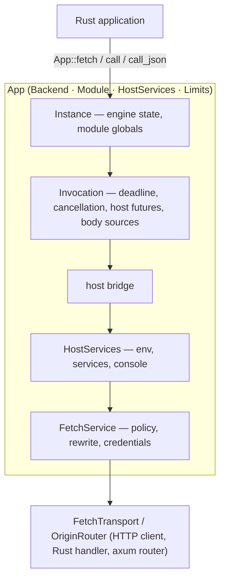

This page names the parts of fetchlet and what each one owns. [Data
flow](/docs/concepts/data-flow) follows a build and a request through them.

## Build side

| Part         | What it is                                                                                        |
| ------------ | ------------------------------------------------------------------------------------------------- |
| Adapter      | A framework integration in the `fetchlet` npm package (`fetchlet/sveltekit`, `fetchlet/astro`, …) |
| Profile      | The Web API layer in `fetchlet/runtime`, shared by every engine                                   |
| Polyfill set | What `fetchlet/build` adds for the target engine, such as FormatJS Intl for QuickJS and Boa       |
| Artifact     | The build output: `server.js`, `fetchlet.json` and the client assets, optionally as `assets.flpk` |

`server.js` is one IIFE that assigns the bundle's exports to
`fetchletExports`. The Fetch entry, `handle` by default, converts the wire
request into a Web `Request` and the returned `Response` back. Other exports
are plain functions. `fetchlet.json` records the handler name, the target
backend, the required APIs, the chosen polyfills and the asset archive.
[`fetchlet/build`](/docs/javascript/build) describes the build.

## Runtime side

### Module and Backend

`Module` holds the built source. `Backend` selects the engine: `quickjs`
(default feature), `boa` or `v8`. Several engine features can be enabled at
once. `QuickJsOptions`, `BoaOptions` and `V8Options` carry engine-specific
heap, stack and recursion settings.

### App and AppBuilder

`App::builder(backend)` takes a module, `HostServices`, `Limits` and the name
of the Fetch entry. `build()` returns an `App` owned by the calling thread;
calls take `&mut self` and run one at a time.

| Call                          | Arguments and result                                          |
| ----------------------------- | ------------------------------------------------------------- |
| `call(export, &input)`        | One Serde value in, one Serde value out                       |
| `call_json(export, &[...])`   | Several JSON arguments, one JSON value out                    |
| `fetch(request)`              | `http::Request<Body>` in, `http::Response<Body>` out          |
| `fetch_with_context(r, &ctx)` | As `fetch`, with a Serde value as the entry's second argument |
| `finish_background()`         | Waits for work registered with `waitUntil`                    |

### AppHandle and WorkerOptions

`AppBuilder::spawn(WorkerOptions)` starts the app on worker threads and
returns an `AppHandle`, which is `Clone + Send + Sync`. The handle owns the
queue (`queue_capacity`), the workers' native stack size,
`response_body_queue` and `instances`: each worker thread owns one instance
and runs one call at a time, and the queue goes to whichever is free. The
pool starts `min` instances, adds one when a command waits and every
instance is busy, up to `max`, and retires instances above `min` after
`idle_timeout`. Dropping a call's future cancels that call. An instance
that became unusable is rebuilt from the same module, bindings and settings
after that call. `shutdown()` stops accepting calls and waits
for accepted ones and their resources.

### Instance

An instance is the engine state: the evaluated module and its globals. It
persists across calls, so module-level state is reused. An instance is
retired, and later rebuilt, when its state is uncertain: after a cancelled
call, an exceeded deadline, or a call that returned while host fetches were
still pending. Under `CancelledCalls::Finish`, a worker option for
development, a cancelled call runs on until its evaluation returns and then
ends like any other, so only the deadline and pending host fetches retire
the instance. A JavaScript exception with no pending work leaves it
reusable. `App::is_reusable()` reports the state.

### Invocation

An invocation is one call. It owns:

- the call's deadline and cancellation;
- every host future the call starts, polled directly and dropped when the
  invocation ends;
- the byte store for binary bodies and the body sources for streamed request
  and upstream bodies;
- the background tasks registered with `waitUntil`, within
  `background_tasks` and `background_timeout`;
- the trusted `Context` taken from the request's extensions.

An unfinished response body keeps its invocation, and therefore its
instance, until the body completes, fails or is cancelled.

### HostServices

The authority an app receives, fixed before the module is evaluated:

- `env(name, value)`: read-only values in `fetchlet.env`;
- `service(name, FetchService)`: named bindings with a `fetch` method;
- `outbound(FetchService)`: the service behind global `fetch`;
- `console(callback)`: where `console.*` output goes.

Without an outbound service, global `fetch` is denied.

### FetchService, FetchPolicy and transports

`FetchService` applies one order to every outbound request: rewrite,
authorize the final origin, attach credentials, send through a single-hop
`FetchTransport`, and repeat the checks on each redirect. `FetchPolicy`
lists the allowed origins. A transport is any trusted Rust implementation:
an HTTP client, a `transport_fn` closure, a Tower service
(`fetchlet_http::service_transport`) or an axum router
(`fetchlet_http::router_transport`).

`OriginRouter` maps exact origins to transports. Internal routes receive the
invocation's `Context`; external routes do not. [In-process
fetch](/docs/rust/in-process-fetch) states the contract.

### Context

A typed set of values that Rust builds — an authenticated principal, a
tenant, a trace parent — and places in the request's extensions. JavaScript
can neither read nor forge it. The Serde value of `fetch_with_context` is the
separate, visible counterpart.

### Body

`Body` implements `http_body::Body`. It holds a buffer, a stream produced by
the worker, or any wrapped `http_body::Body` (`Body::from_http_body`).
Binary bodies and repeated headers such as `Set-Cookie` are preserved.

### Limits

Caller budgets, each an `Option`, all `None` by default: timeout, body bytes
and chunks, header and URL bytes, bridge message bytes, digest input,
subrequests, redirects and background work. [Resource
policy](/docs/rust/resource-policy) gives each one's scope and the limits that come
from specifications instead.

## HTTP side

`fetchlet-http` serves an `AppHandle`:

| Part                                          | Role                                                                                      |
| --------------------------------------------- | ----------------------------------------------------------------------------------------- |
| `FetchletService`                             | Tower service over `http` 1: public origin, body budgets, context, error mapping          |
| `HyperService`, `AxumService`, `ActixService` | Thin layers for each server (Cargo features)                                              |
| `Artifact`                                    | Reads `fetchlet.json`, `server.js` and the asset archive; `include_artifact!` embeds them |
| `AssetArchive`, `AssetService`                | Serves client assets from an archive; other requests reach the app                        |
| `artifact_router`                             | An axum router that combines the two                                                      |

[Serving over HTTP](/docs/rust/fetchlet-http) documents the request
handling rules and error statuses.
