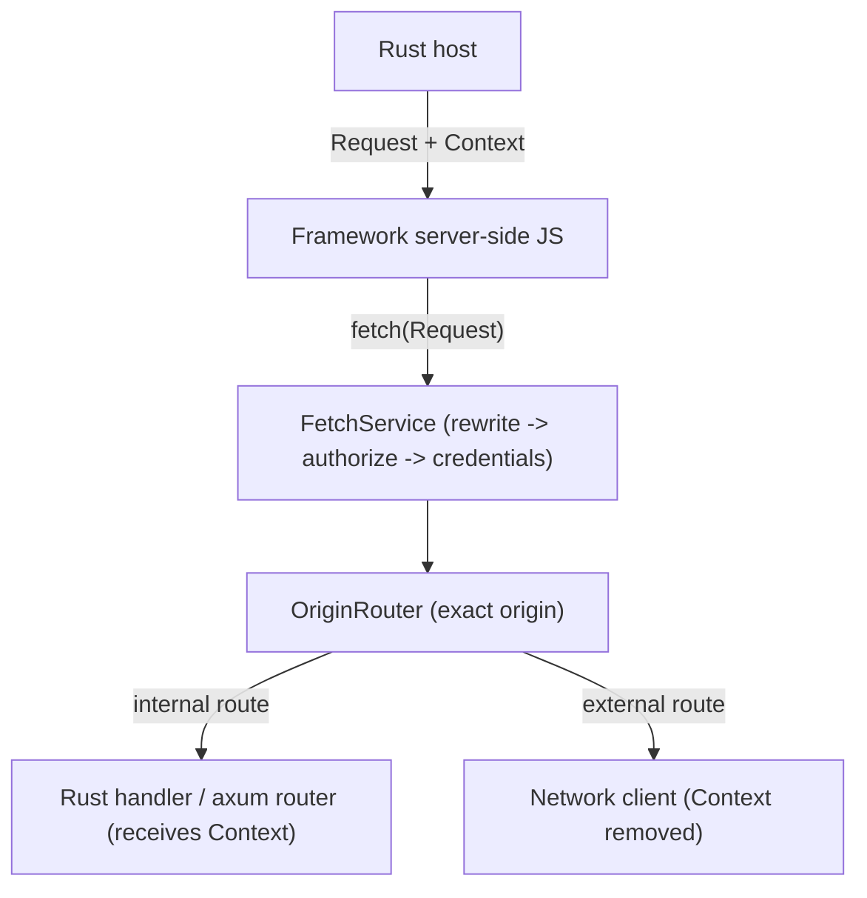

Server-side JavaScript can call your Rust handlers and axum routers through
standard `fetch()` without opening a TCP connection. `OriginRouter` routes
requests by exact origin, forwards a trusted `Context` to internal routes only,
and prevents deadlocks from reentrant calls.



## Quick example

```rust
use fetchlet::{HostServices, OriginRouter};
use fetchlet_http::router_transport;
use fetchlet_net::HttpClient;

let service = OriginRouter::new()
    .internal("https://fetchlet.internal", router_transport(api_router(state.clone())))?
    .external("https://api.example.com", HttpClient::new())?
    .into_service();

let hosts = HostServices::new()
    .outbound(service.clone())
    .service("API", service)?;
```

| API                                 | Role                                                                          |
| ----------------------------------- | ----------------------------------------------------------------------------- |
| `OriginRouter::internal(origin, t)` | Registers a trusted transport for an origin; receives the invocation `Context`|
| `OriginRouter::external(origin, t)` | Registers an untrusted transport for an origin; `Context` is stripped         |
| `OriginRouter::into_service()`      | Builds a `FetchService` allowing only the registered origins                  |
| `FetchTransport` / `transport_fn`   | Connects any async Rust function as a single-hop transport                    |
| `fetchlet_http::router_transport`   | Wraps an axum `Router` as a transport (`axum` feature)                        |
| `fetchlet_http::service_transport`  | Wraps any Tower service as a transport                                        |
| `trusted_context`                   | Builds a `Context` from incoming HTTP requests on `fetchlet-http` services    |
| `FetchService::forward_context()`   | Forwards `Context` on a single-transport `FetchService` without `OriginRouter`|

## Exact origin routing

`OriginRouter` compares normalized `scheme://host:port` origins:

- Registered origins go strictly to their mapped transport (HTTP `404` or `500`
  from the transport resolves as a normal `Response` in JavaScript).
- Any unregistered origin is rejected with `PERMISSION_DENIED` without calling
  any transport or touching the network.
- Every redirect hop is re-authorized; a redirect from an internal origin to an
  external origin succeeds only if the external origin is registered, and strips
  the `Context`.

### Naming internal origins

Use `https://` URLs under the ICANN-reserved `.internal` top-level domain (such
as `https://fetchlet.internal` or `https://api.fetchlet.internal`):

- Standard `https://` origins work seamlessly with WHATWG URL parsing, Fetch
  `Request`, and framework HTTP clients (unlike custom schemes such as
  `fetchlet://`, which have opaque `null` origins).
- `.internal` is never delegated in public DNS, preventing accidental collisions
  with external websites.
- Internal origins are for **server-side JavaScript only**; browsers continue to
  call public relative paths (such as `/api/v1`) on the same axum router.

## Trusted `Context`

`fetchlet::Context` holds typed Rust values (such as an authenticated user,
tenant ID, or trace context) attached to an incoming request via
`trusted_context(|parts| ...)` on `fetchlet-http` services:

- JavaScript cannot read, create, or forge `Context`, and it is never derived
  from headers set by JavaScript.
- All in-process fetches made during that invocation automatically receive a
  clone of the `Context` in their request extensions.
- axum handlers read it with `Option<Extension<fetchlet::Context>>`.
- Redirects between internal routes preserve `Context`; external routes never
  receive it.

If you want to pass data that **is** visible to JavaScript, use
`App::fetch_with_context` (or `context(...)` on `fetchlet-http` services).

## Reusing an axum router

`router_transport(router)` lets a single axum `Router` serve both public browser
requests and in-process server-side `fetch()` calls:

- Method, URI, headers, body, and extensions pass through directly; response
  bodies stream back within `Limits::response_body_bytes`.
- Aborting the JS `fetch()` (via `AbortSignal`) or ending the invocation drops
  the axum handler's future immediately.
- In-process calls have no TCP `ConnectInfo`; pass identity or metadata via
  `Context` instead.

## Reentrancy

Because each engine instance processes one invocation at a time, calling the
same `AppHandle` from inside one of its own host fetches would deadlock.
fetchlet detects direct reentrant calls on the worker thread and fails them
immediately with `Error::Reentrant` (`REENTRANT` in JavaScript). Calls to a
*different* `AppHandle` work normally.

Avoid spawning a separate `tokio::spawn` task inside a transport that calls back
into the same `AppHandle` and awaits it — that cannot be detected as reentrant
and will wait until `Limits::timeout`.

## Framework fetches

Some frameworks intercept relative or same-origin fetches inside JavaScript
before they reach global `fetch()`:

| Framework                                                  | Stays inside JavaScript (no host fetch)                                                                              |
| ---------------------------------------------------------- | -------------------------------------------------------------------------------------------------------------------- |
| SvelteKit                                                  | `event.fetch` with a relative or same-origin URL                                                                     |
| Nuxt and Nitro                                             | `event.$fetch` and `event.fetch` with a path (keeps `event.context.fetchlet`); global `$fetch` with a path (no context) |
| SolidStart                                                 | `fetchWithEvent(event, path)` from `@solidjs/start/http`                                                             |
| TanStack Start, Astro, React Router, Qwik City, Waku, vinext, HonoX, Solid | None — call loaders/functions directly, or use `fetch` to an allowed internal origin                      |

An absolute URL passed to global `fetch()` (even on the public origin) always
goes through Rust's `FetchPolicy`. Named bindings such as `env.RUST.fetch(...)`
always call their bound Rust service directly.
